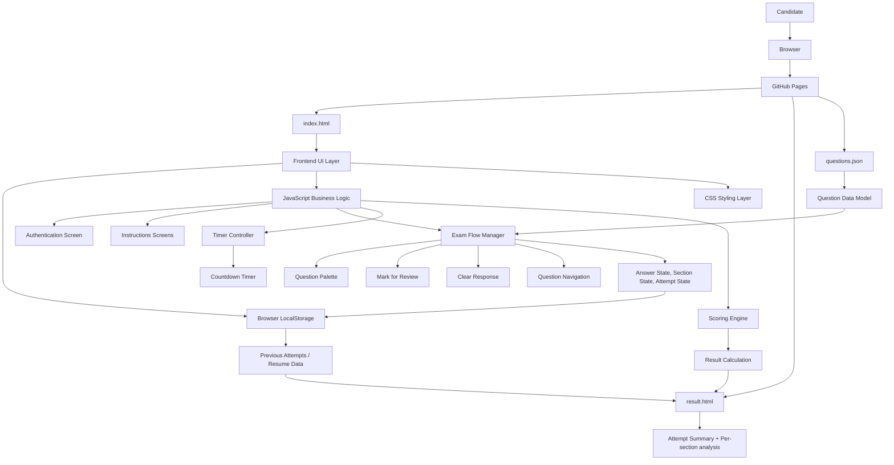
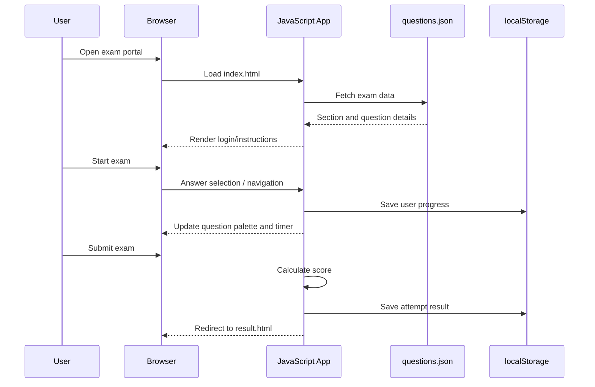

# Dsssb PYQ Exam Portal - Architecture Overview

This project is a static exam portal built using HTML, CSS, and JavaScript. It is designed to run as a client-side application hosted on GitHub Pages and uses a local JSON question bank to render the exam experience dynamically.



## High-Level Purpose

The portal simulates a competitive exam experience with:

- login screen
- instruction screens
- multilingual support (English/Hindi)
- sectional exam navigation
- question palette / status tracking
- timer countdown
- mark-for-review behavior
- negative marking logic
- final result summary

## Main Components

### 1. Presentation Layer
- `index.html`: Main application shell and all exam screens are rendered from this file.
- `result.html`: Displays final score breakdown and attempt summary.
- CSS embedded in `index.html`: Controls the full visual design and page layout.

### 2. Data Layer
- `questions.json`: Contains the actual exam question bank and section metadata.
- Questions are organized by sections, with each question containing:
  - question text
  - answer choices
  - correct answer index
  - language-specific variants
  - explanations/solutions

### 3. Application Logic
- JavaScript embedded in `index.html` manages:
  - screen switching
  - language toggling
  - timer logic
  - state tracking for each question
  - answer selection and validation
  - save/next navigation
  - section summary and final submission
  - scoring with negative marking
  - browser storage persistence

### 4. Persistence Layer
- `localStorage` is used to store:
  - current exam data
  - attempt history
  - last attempt reference
  - review/resume metadata

## Runtime Flow

1. The browser loads the site from GitHub Pages.
2. `index.html` is executed.
3. The script fetches `questions.json`.
4. The exam is initialized and screens are rendered.
5. The user answers questions, marks questions for review, and moves through sections.
6. State is stored in memory and in `localStorage`.
7. Once exam submission occurs, the app calculates marks and redirects to `result.html`.
8. A detailed result record is stored in browser storage for review or resume.

## Architectural Characteristics

- Static frontend only: no backend server required
- Browser-driven application state
- Client-side exam logic
- Data-driven rendering from JSON
- GitHub Pages friendly deployment model
- Simple architecture optimized for speed and portability

## Typical Request Flow



## Summary

The project is a lightweight static exam portal that behaves like a dynamic web application despite having no backend. It uses browser-side JavaScript for the entire exam lifecycle and stores persistent state locally, making it ideal for static hosting and easy deployment.

## File Structure

```text
Dsssb-PYQ-exam-portal/
├── index.html
├── result.html
├── questions.json
├── ARCHITECTURE.md
└── (GitHub Pages deployment)
```

If you want, I can also create a second version that is:
- more visually polished,
- more concise,
- or designed specifically for a README/portfolio presentation.
