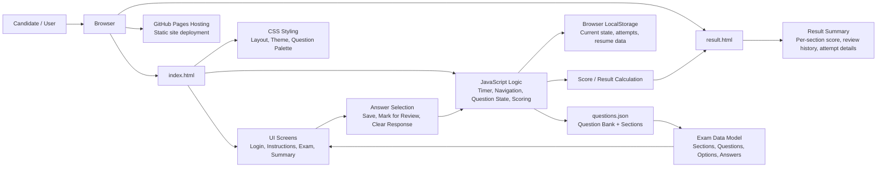

# Architecture Overview

This project is a static exam portal delivered as client-side HTML, CSS, and JavaScript. The application loads exam configuration from a JSON file and manages exam flow, timer, scoring, and review behavior entirely in the browser.

## Components

- `index.html`: Main exam interface and app shell
- `result.html`: Result page for final score summary and attempt analysis
- `questions.json`: Exam question bank and section metadata
- `LocalStorage`: Persists current attempt and prior results in the browser
- JavaScript logic: Handles state transitions, timer logic, question rendering, scoring, and review mode
- CSS: Provides the styling and layout for the portal

## Runtime Flow

1. The browser loads `index.html`.
2. JavaScript fetches `questions.json` and initializes the exam state.
3. The user progresses through login, instructions, and live exam screens.
4. Answers and statuses are stored in memory and in `localStorage`.
5. On completion, the app calculates marks, stores the attempt, and redirects to `result.html`.
6. The static site is served from a GitHub Pages deployment.
